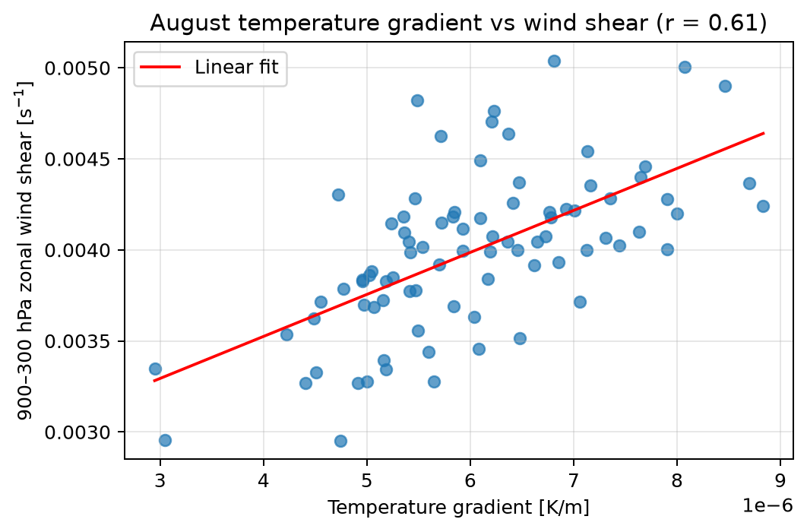
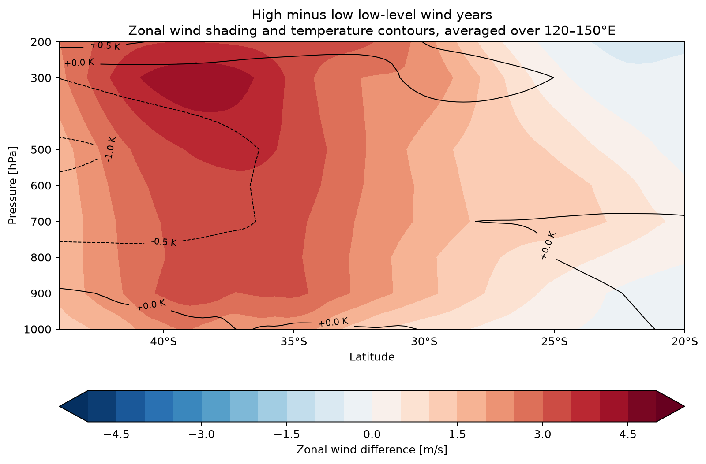

# 澳大利亚八月温度梯度与风场分析

## 项目简介
分析澳大利亚区域八月温度梯度与垂直纬向风切变的关系，并检验低层风速较强年份的高空风场差异是否在空间上均匀分布。项目基于 ERA5 月平均资料，形成统计结果、空间图、垂直剖面和研究报告。

## 我的贡献
- 整理 1940—2024 年共 85 个八月样本，计算指定区域的温度梯度、风切变及低层风强指数。
- 使用相关分析、最小二乘拟合和高低分位数组合，对不同变量的关系进行比较。
- 绘制水平风场图和经向—高度剖面，并结合热成风关系解释结果与局限。

## 技术栈
Python、Jupyter Notebook、xarray、NumPy、Matplotlib、Cartopy、ERA5 再分析数据；方法包括区域平均、Pearson 相关、线性拟合与组合分析。

## 结果或演示
- 温度梯度与近似 900—300 hPa 纬向风切变呈正相关（r = 0.614），符合热成风关系的定性预期。
- 低层风强指数与区域平均 200 hPa 纬向风的相关性较弱（r = 0.200）；组合图显示高空差异具有明显空间变化，不能用单一低层指数概括整个区域。
- 完成包含 8 张核心图的研究报告。以下展示其中两张；上述结论限于指定时段、区域与月平均数据，不将相关性表述为因果关系。

**图 1｜温度梯度与风切变的线性关系（图中 r 四舍五入为 0.61）**

**图 2｜低层风强年份的高低组合差异：纬向风与温度垂直剖面**

## 如何运行
分析使用 Python 3 与 Jupyter Notebook，并依赖 xarray、NumPy、Matplotlib 和 Cartopy。原始 ERA5 NetCDF 数据不随仓库分发；Notebook 公开前需把本机数据路径改为相对路径并复核运行结果。当前页面展示经报告核对的研究问题、方法、关键结果及两张结果图。
